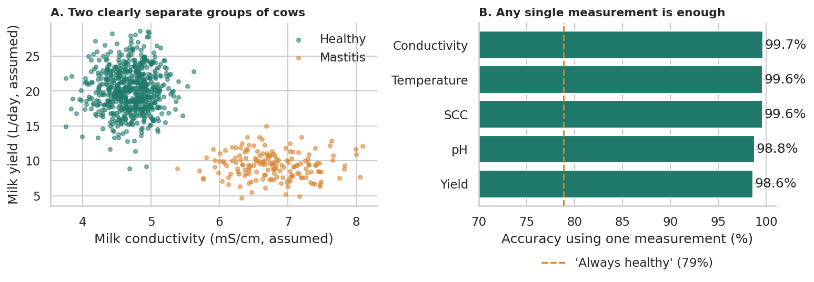

# Detecting Mastitis from Milk Measurements: is machine learning even needed?

A data science project on milk measurements from 800 dairy cows (169 with mastitis). The first model scored **100% accuracy**, which is a result to question, not celebrate. This project tests why, shows that a one-line threshold rule does as well as machine learning, and finds strong evidence that the data is simulated.



## Key findings

- **Mastitis milk looks very different.** Compared with healthy cows: about 2.5 °C warmer (38.05 vs 35.54), pH 7.11 vs 6.65, conductivity 45% higher (6.78 vs 4.69), somatic cell count (SCC) four times higher (598 vs 148) and yield 54% lower (9.35 vs 20.15). Every effect size (Cohen's d) is between 4.2 and 5.1.
- **Detection is trivially easy, even without SCC.** Logistic regression on the four non-SCC measurements makes zero errors in 800 cows under repeated cross-validation. Any single measurement reaches 98.6–99.7% accuracy, against 78.9% for always guessing "healthy".
- **A one-line rule matches the models.** "Milk temperature above 36.84" gives 0 missed cases and 1 false alarm in 800 cows; "conductivity above 5.66" gives 1 missed case and 0 false alarms.
- **Removing SCC does not fix the "too good" result.** SCC is a standard diagnostic criterion, but every other measurement separates the classes just as well, so the whole dataset is too separable, not one column.
- **Clotting is perfectly specific but incomplete:** all 138 clotting cows have mastitis, but 31 of 169 mastitis cows (18%) do not clot.
- **The data is almost certainly simulated.** Within each group the measurements are essentially uncorrelated (average |r| = 0.05), while overall they correlate at 0.80. In real animals the measurements would stay correlated within a health group.

| Model / measurements | Accuracy | Recall (mastitis caught) |
|---|---|---|
| Logistic regression, all 5 measurements | 100% | 100% |
| Logistic regression, 4 without SCC | 100% | 100% |
| Random forest, 4 without SCC | 99.9% | 100% |
| Temperature alone | 99.6% | 98.8% |
| Conductivity alone | 99.7% | 98.4% |
| "Always healthy" guess | 78.9% | 0% |

*Repeated 5-fold stratified cross-validation (3 repeats).*

## What I changed compared with the original notebook

| Original approach | This project |
|---|---|
| One 80/20 split (160 test cows, 34 with mastitis) | Repeated stratified cross-validation (15 test sets) |
| Accuracy only | Accuracy, recall, precision and AUC, with a "always healthy" baseline (21% of cows have mastitis) |
| Dropped SCC to fix "leakage" | Tested the explanation: results are unchanged, so the real cause is separable (simulated) data |
| Unscaled logistic coefficient chart | Standardised coefficients so measurements are comparable |
| Conclusion that mastitis is "linearly separable" | Quantified it: effect sizes, overlap zones, single-measurement accuracy, threshold rules |
| Clotting and `Day` left out without comment | Explained why: clotting is a second label (a clinical sign); `Day` has no signal (r = −0.002) |
| No check on whether the data is realistic | Within-group correlation analysis showing the signature of simulated data |

## Repository structure

```
mastitis-detection-analysis/
├── README.md
├── requirements.txt
├── data/
│   └── README.md              # how to download the dataset (CSV not included)
├── notebooks/
│   └── mastitis_detection_analysis.ipynb
├── figures/                   # charts exported by the notebook
└── report/
    └── Mastitis_Project_Report.docx   # 3-page plain-language report
```

## Notebook contents

| Section | What it covers |
|---|---|
| 1–3 | Setup, loading, cleaning, data dictionary |
| 4 | Quality checks: balance, outliers, `Day`, clotting |
| 5 | Differences between mastitis and healthy milk (effect sizes, overlap zones) |
| 6 | Is the data realistic? Within-group correlation analysis |
| 7 | Modelling: repeated cross-validation, single-measurement tests, threshold rules, standardised coefficients |
| 8–10 | Conclusions, limitations, next steps |
| Appendix | Summary chart used in the report |

## How to run

```bash
# 1. Clone and enter the repo
git clone https://github.com/dhappo/mastitis-detection-analysis.git
cd mastitis-detection-analysis

# 2. Create an environment and install dependencies
python -m venv .venv
source .venv/bin/activate        # Windows: .venv\Scripts\activate
pip install -r requirements.txt

# 3. Download the dataset (see data/README.md) into data/

# 4. Open the notebook
jupyter notebook notebooks/mastitis_detection_analysis.ipynb
```

The notebook uses relative paths and fixed random seeds, and runs top to bottom. Charts are saved to `figures/`.

## Dataset

`cow_milk_mastitis_dataset.csv`, downloaded from Kaggle (add the dataset link here). The dataset does not document its units; the notebook assumes °C, mS/cm, thousands of cells/mL and litres/day, and its conclusions rely only on relative differences. The raw file is never modified and is not redistributed here. Please check the source page for licence and citation terms.

## Limitations

- **The data looks simulated** (independence within groups, very tight spreads, perfect separation), so no accuracy figure describes real herd performance.
- **One measurement per cow:** no repeated measures, so early detection and progression cannot be studied.
- **Undocumented units and `Day`;** no breed, farm or lactation-stage information.
- **A single group of cows:** generalisation to other farms is untested.
- **Clinical vs subclinical mastitis is not distinguished,** and the source of the label is unknown.

## Possible next steps

- Repeat on real farm data with repeated measures per cow and a hold-out of whole farms.
- Compare thresholds and models on recall at a fixed false-alarm rate rather than raw accuracy.
- Study early detection: can measurements flag mastitis days before clinical signs?
- Wrap the threshold rule in a small farm-facing app.

## Background

Pan et al., *Machine learning-based clinical mastitis detection in dairy cows using milk electrical conductivity and somatic cell count*, Frontiers in Veterinary Science (2025), doi:10.3389/fvets.2025.1671186. The authors note that conductivity thresholds are limited by low specificity and farm-specific variability, a useful contrast with how clean this dataset is.

## Author

**Abdulsobur Abiola Oladapo (Dapo)** — data analysis and machine learning  
Portfolio: <https://abdulsobur-oladapo.lovable.app>
